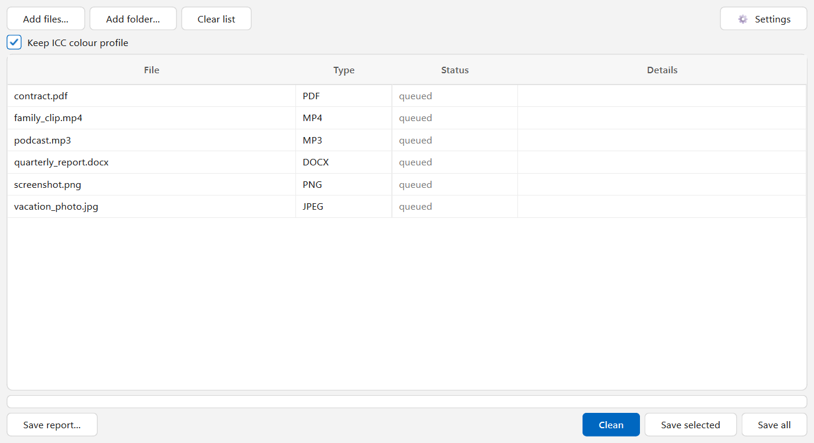
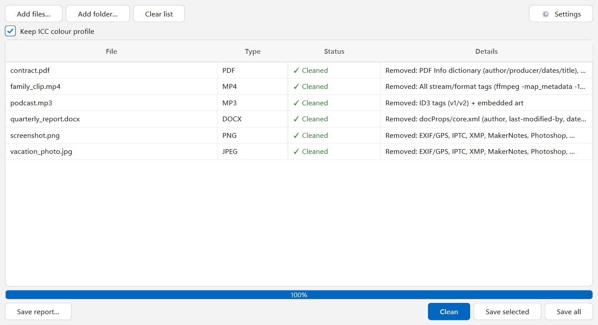
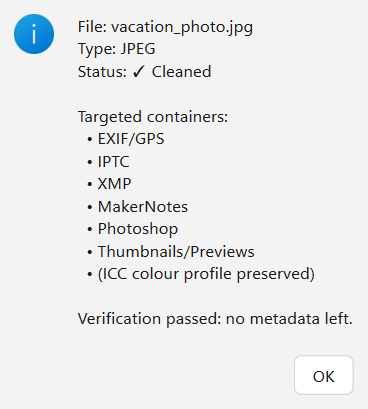
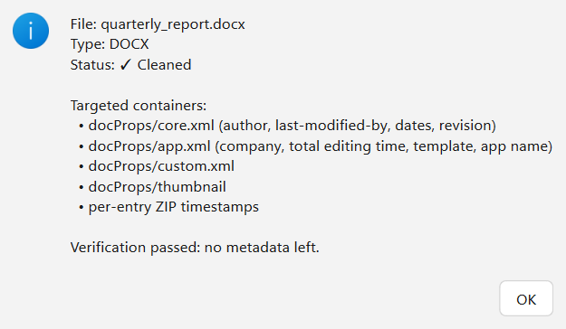
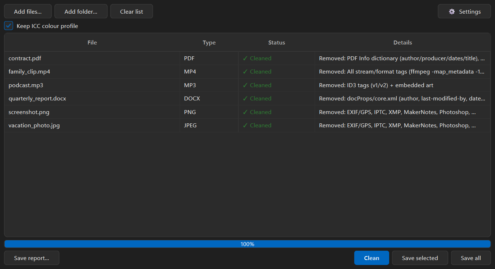
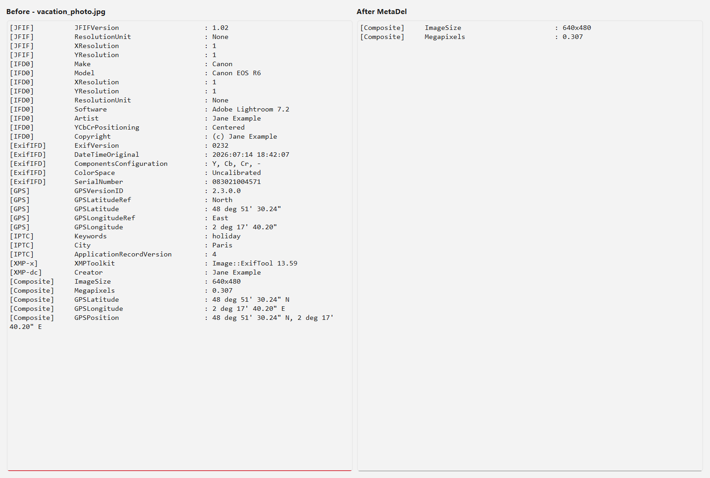

# MetaDel

A Windows desktop app that removes hidden metadata from files before you share them: GPS location, camera and author details, document properties, and tags in audio and video. It works completely offline and checks every file again after cleaning to make sure nothing was left behind.

## Features

- **Many Formats:** Photos (JPEG, PNG, WebP, TIFF, HEIC), RAW (CR2, CR3, NEF, ARW, DNG), PDF, Word, Excel, PowerPoint, MP3, FLAC, MP4 and MOV.
- **Verification:** Every file is read again after cleaning and only marked as cleaned if no metadata is left.
- **Originals Stay Safe:** Cleaning happens on a copy. You choose whether to replace the original or save a separate `_clean` copy.
- **File Details:** Double-click a file to see exactly what was removed.
- **Drag and Drop:** Add single files or whole folders.
- **Offline:** The app never connects to the internet.
- **Themes and Languages:** Light and dark theme, English and Ukrainian.

Built with Python and PySide6, using ExifTool, FFmpeg, pikepdf and mutagen.

---

## Screens

### Files Added


### Cleaned Files


### File Details



### Dark Theme


### Before and After
A test photo with camera, author and GPS data, before and after cleaning.



## Run it

**Windows app:** Download `MetaDel.exe` from Releases and keep the `tools` folder next to it. `ffmpeg.exe` is too big for GitHub, so download it separately and put it in `tools` (see [tools/README.txt](tools/README.txt)).

**From source** (Python 3):

```bash
pip install -r requirements.txt
python -m metadel
```

Command-line usage and more details are in [docs/USAGE.md](docs/USAGE.md).
